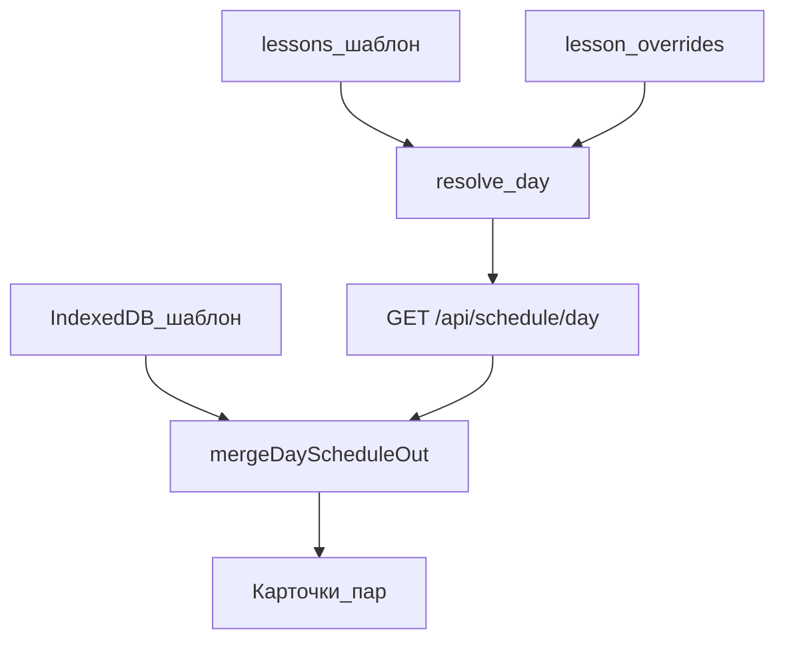

# Данные

Две модели одного расписания: нормализованные строки SQLite и документ `ScheduleData` в браузере. Словарь терминов — [[Глоссарий]].

## SQLite

Файл: `DATABASE_PATH` (в Docker `/app/data/schedule.db`, том `./backend/data`). Схема создаётся при каждом коннекте (`backend/app/db.py`, константа `SCHEMA`).

### `lessons`

Шаблон семестра. Поля: `group_name`, `day` (русское имя дня: «Понедельник» …), `pair`, `week` (`green`|`red`), `subject`, `teacher`, `room`. Индекс `(group_name, week)`.

Занятие «на обе недели» — **две** строки. `replace_schedule` делает `DELETE FROM lessons` и вставляет новый набор.

### `meta`

Ключ–значение: `filename`, `uploaded_at` (UTC ISO), `title` (строка с «расписан» из шапки листа).

### `rooms`, `teachers`

Справочники после последней загрузки. Имена нормализованы в `catalog.py`. Текст в `lessons` может отличаться (лишние пробелы, «Башилова Ю.А» без точки).

### `bell_regular`

`pair` PK, `start_time`, `end_time`. Одна сетка на все дни с точки зрения API.

### `bell_short_dates`, `bell_short_days`

Дата сокращённого дня и её слоты. Пустой список слотов при помеченной дате всё равно `kind: short`.

### `lesson_overrides`

PK `(on_date, group_name, pair)`. `cancelled` 0/1, иначе новые subject/teacher/room. Upload Excel эти строки не чистит.

## Что не хранится на сервере

- Отдельные сетки понедельника и четверга.
- Кураторский час.
- Локальный список substitutions админки, журнал аудита, темы, выбранная группа.
- Воскресенье как учебный день в клиентской сетке.

## Клиент: `ScheduleData`

Собирается в `adapt.js` / `schedule.js`:

- `version`, `updatedAt`, `meta` (institution из title API, semester из week+границ, `sourceFile: 'api'`).
- `groups` → дни `'1'..'6'` → уроки.
- `substitutions[]` — локальный журнал мастера замен, не ответ `/api/schedule/day`.
- `settings` — в том числе `apiWeek`, `weekStart`, `weekEnd`, `pairTimes`.
- `catalog.rooms` / `catalog.teachers` после `GET /api/rooms` и `/api/teachers`.

### Неделя: два словаря

| Сервер | Клиент | ISO-неделя |
| --- | --- | --- |
| `green` | `odd` | нечётная |
| `red` | `even` | чётная |
| занятие на обе (две строки) | два урока с разным `week` | — |

Публичный фильтр текущего дня использует `getMelmkWeekType` → `odd`/`even` (`filterByWeek`). Слитый день с API помечает уроки `week: 'all'`, потому что дата уже фиксирована.

## Слияние для экрана

`mergeDayScheduleOut` сравнивает ответ с локальным шаблоном той же пары и ставит `replaced` / `original`, если subject/teacher/room отличаются. Отменённые пары на экран не попадают.
