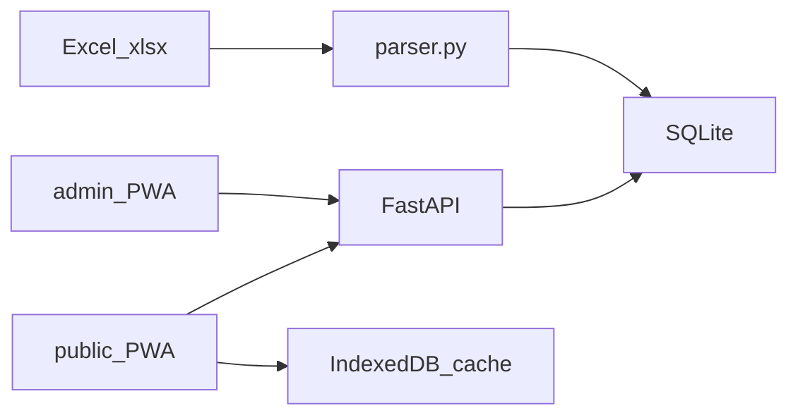

# Архитектура: обзор

MelMK-Schedule — расписание колледжа: Excel семестра попадает в SQLite, HTTP API отдаёт его по группе, PWA показывает день, неделю и месяц.

Подробнее: [[architecture/Бэкенд]], [[architecture/Фронтенд]], [[architecture/Данные]], [[architecture/API]], [[architecture/Развёртывание]]. Процессы — [[processes/Обзор]].

## Стек

| Слой | Технологии |
| --- | --- |
| Публичный UI и админка | Vanilla JS (ES-модули), CSS, PWA (`frontend/sw.js`, `frontend/manifest.json`), без React/Vue |
| API | FastAPI, Pydantic, CORS `*` |
| Парсер Excel | openpyxl (`backend/app/parser.py`) |
| БД | SQLite, миграции `backend/app/migrations/versions/` (`python -m app.migrate`), Alembic нет |
| Деплой | Docker Compose: образ бэкенда + nginx 1.27 со статикой `frontend/` |

## Компоненты

- **Бэкенд** (`backend/app/`): единственное место, где шаблон семестра становится строками `lessons`.
- **Публичный PWA**: читает API, кэширует, для видимых дат запрашивает уже слитый день (`/api/schedule/day`).
- **Админка**: тот же кэш расписания плюс запись на API (upload, overrides), если задан токен.

## Источник данных

1. Администратор загружает `.xlsx` на `POST /api/admin/upload`.
2. `parse_workbook` разбирает все листы; `replace_schedule` заменяет `lessons`, `rooms`, `teachers` и метаданные файла.
3. Публичная страница при старте: `syncBootstrap` → `GET /api/info` и `/api/groups`, затем шаблон выбранной группы с обеих недель (`green` и `red`).
4. Для открытого дня/недели/месяца `hydrateDayOverrides` подтягивает `/api/schedule/day` и кладёт результат в кэш `substitutions.js`.

Локальный разбор Excel в админке без токена **не** пишет в SQLite: только IndexedDB этого браузера.

## Два контура звонков

Сервер хранит одну регулярную сетку и исключения по датам. Клиент дополнительно хранит отдельные сетки понедельника и четверга и кураторский час. См. [[processes/Звонки]].

## Безопасность (как есть)

- Мутации API: сравнение `X-Admin-Token` с `ADMIN_TOKEN` (`secrets.compare_digest`). По умолчанию токен `dev`.
- Экран `/admin/`: хэши логина и пароля лежат в `frontend/js/config.js`. Это барьер от случайного входа, не серверная сессия.
- CORS разрешает любые origin.
