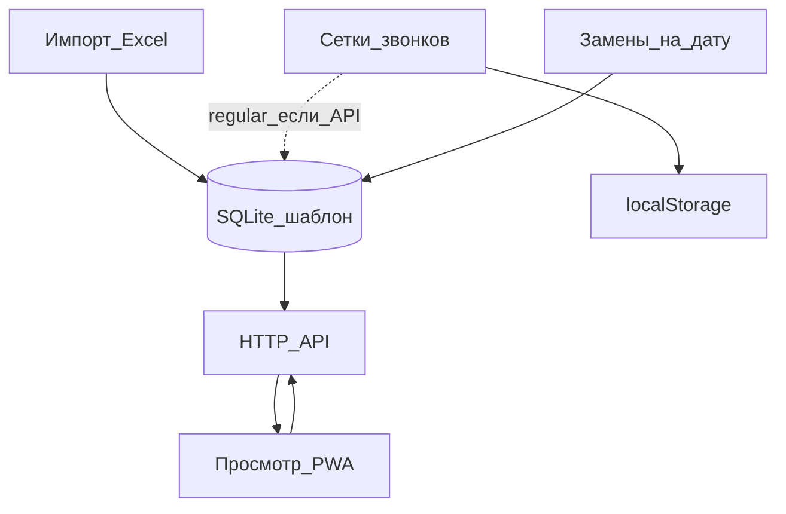

# Процессы: обзор

Кто что делает в MelMK-Schedule и где это заканчивается в коде.

Архитектура: [[architecture/Обзор]]. Роли и вход: [[processes/Администрирование]]. Термины: [[Глоссарий]].

## Карта процессов

| Процесс | Кто | Заметка |
| --- | --- | --- |
| Посмотреть пары, звонки, преподавателей | студент / преподаватель | [[processes/Просмотр расписания]] |
| Залить сетку семестра | администратор | [[processes/Импорт Excel]] |
| Заменить или отменить пары на даты | администратор | [[processes/Замены]] |
| Времена пар и кураторский час | администратор + устройство | [[processes/Звонки]] |
| Войти в панель, токен, справочники | администратор | [[processes/Администрирование]] |

## Роли

В коде нет ролей в БД. Фактически:

- **Читатель** — любой, у кого открыт `/`. Данные с публичных GET.
- **Администратор UI** — знает логин/пароль `/admin/`. Видит локальный кэш, может править его в этом браузере.
- **Администратор API** — знает `ADMIN_TOKEN`. Может менять SQLite; эти изменения видят все клиенты.

Один человек обычно совмещает два последних, сохранив токен в разделе «Данные».

## Жизненный цикл семестра

1. Получить официальный `.xlsx`.
2. В админке указать токен и загрузить файл на сервер.
3. Студенты открывают сайт, выбирают группу, смотрят текущую зелёную/красную неделю.
4. По ходу семестра: замены и отмены на конкретные даты; при необходимости сокращённый день звонков на сервере; правки сеток пн/чт и кураторского часа — на устройстве админа (они не становятся общими через API, кроме записи `regular`).
5. Новый файл семестра снова затирает шаблон и справочники, замены в `lesson_overrides` остаются.
