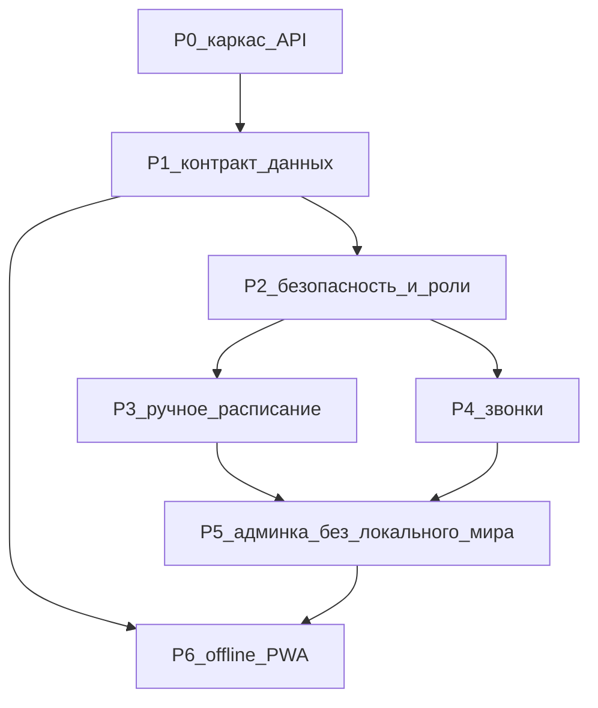

# План изменений

Это **не** описание текущего кода. As-is: [[architecture/Обзор]], [[processes/Обзор]]. Здесь — отфильтрованный бэклог рефакторинга.

Полные карточки: [[roadmap/Задачи]].

## Зачем этот список

Сайт работает как «залили Excel → студенты смотрят в браузере». Дальше нужны: ручное ведение сетки, нормальная безопасность (не хэши в статике), вход преподавателя, офлайн. Без общего порядка эти темы пересекаются (два парсера, два контура звонков, два словаря недели, админка как второй мир в IndexedDB).

Ниже — **один** список. Повторяющиеся формулировки («единая модель», «админка только API», «упростить backend») разложены по конкретным задачам и больше не дублируются отдельными эпиками.

## Решение, которое держим

| Тема | Решение |
| --- | --- |
| Студенты | Публичный просмотр расписания **остаётся без логина** |
| Админ и преподаватель | Входят учёткой; первого админа заводят при деплое, остальных добавляет он |
| Excel | Опциональный импорт в ту же модель, что ручное расписание |
| Источник правды | SQLite + API; браузерный кэш только ускоряет и кормит офлайн |
| Боты Telegram / MAX | **Не в этом репозитории.** Отдельные сервисы, только читают HTTP API. На бэкенде нет webhook, очереди событий и кода мессенджеров |

## Порядок фаз

P0–P1 нужны всем. P2 (безопасность) — до ручных мутаций «как продукт»: иначе снова прикручивать `X-Admin-Token`. Офлайн — после стабильного контракта дня/звонков. Внешние боты, если появятся, зависят только от публичного (и при необходимости авторизованного) API, не от задач этого бэклога.

## Что выкинули как отдельные глобальные темы

Уже покрыто задачами внутри фаз, отдельным эпиком не вести:

- «Админка как клиент API» → R-14, R-16, R-18, R-19, R-20
- «Единая модель green/odd» → R-03
- «Миграции» как эпик → R-02
- «Timezone Москва» → R-03
- «Убить второй парсер» → R-14

Не берём в этот бэклог: темы оформления, горячие клавиши, ICS/печать, смена формулы ISO-недели, отдельный файл OpenAPI в репозитории, Telegram/MAX и любой исходящий webhook с этого бэкенда.

## Как читать карточки

В [[roadmap/Задачи]] у каждой задачи: зачем, как сейчас, что сделать, что **не** входит, критерий готовности, зависимости. Идентификаторы стабильные (`R-01` …): на них ссылаться из чатов и следующих заметок декомпозиции в код.
